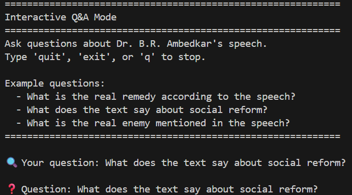
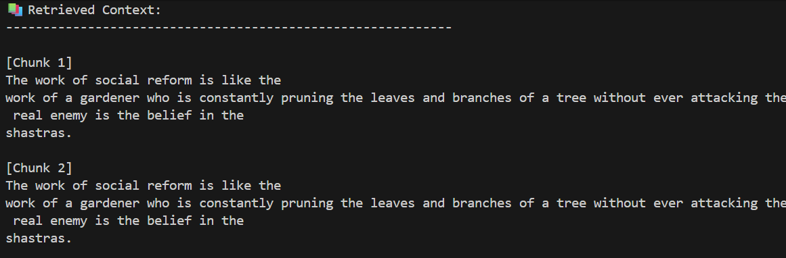

# Semantic-Search-QA
A Retrieval-Augmented Generation (RAG) project built using
**LangChain**, **Groq LLM**, **HuggingFace embeddings**, and
**ChromaDB**.\
This system lets you ask questions about *Dr. B. R. Ambedkar's speech*
using semantic search + LLM reasoning.

## 🚀 Features

-   Load and process any text file
-   Split text into overlapping semantic chunks
-   Embed chunks using **sentence-transformers/all-MiniLM-L6-v2**
-   Store embeddings in **ChromaDB**
-   Retrieve relevant chunks using similarity search
-   Use Groq's **openai/gpt-oss-120b** to generate accurate answers
-   Full interactive Q&A mode with context display

## Implementation

### Main Page (Terminal)

## 📂 Project Structure

    project/
    │── main.py
    │── speech.txt
    │── .env
    │── requirements.txt
    │── README.md

## 🔧 Requirements

Python 3.11 or newer.

Install dependencies:

    pip install -r requirements.txt

## 🔑 Environment Variables

Create a `.env` file:

    GROQ_API_KEY=your_api_key_here

## 📝 How to Run

    python main.py

## 🗂 Recommended .gitignore

    uploads/
    indexes/
    metadata/
    logs/
    temp/
    chroma_db/

## 🧠 RAG Workflow

1.  Load text\
2.  Chunk text\
3.  Embed chunks\
4.  Store in ChromaDB\
5.  Retrieve & answer using Groq LLM